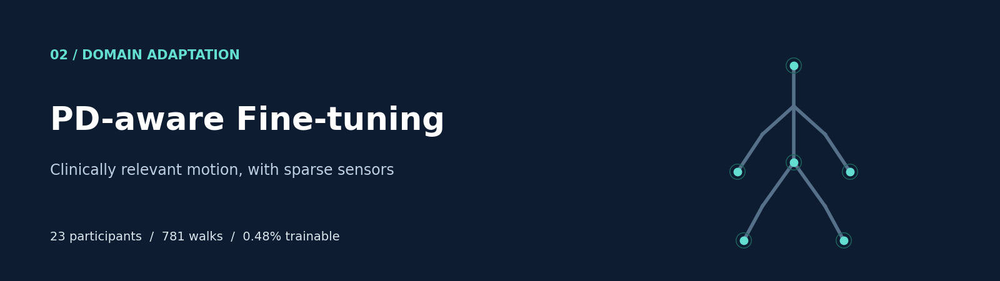
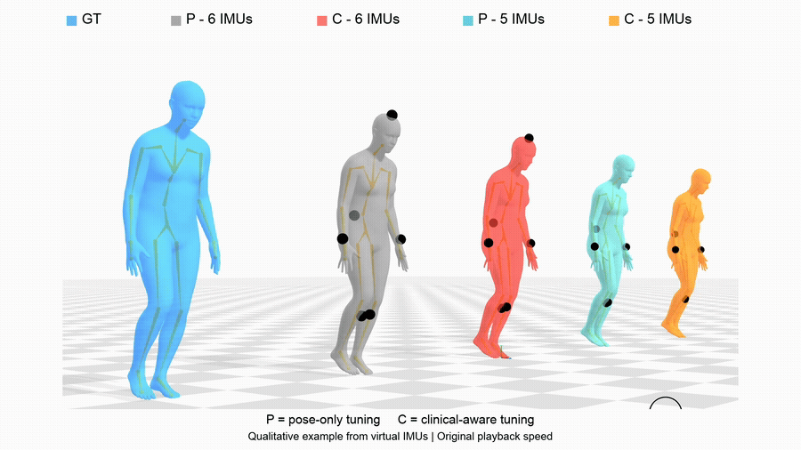
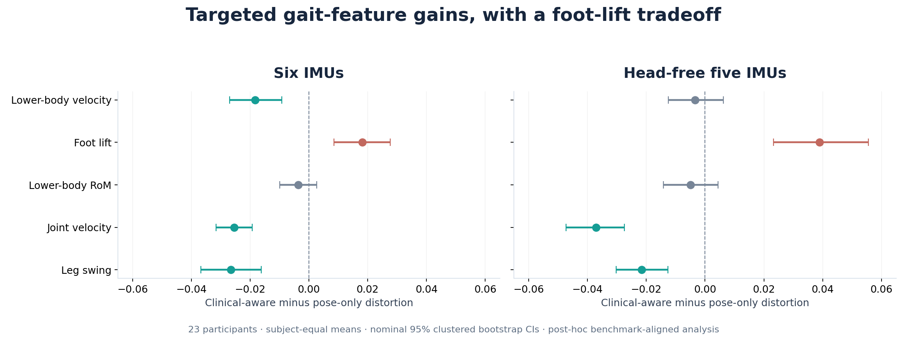
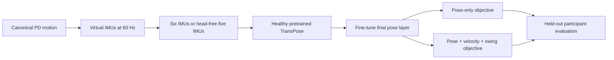

<div align="center">



# PD-aware Fine-tuning
**Preserving clinically relevant gait features with sparse wearable sensors**


[Project page](https://nicoyoung1101.github.io/pd-gait-imu/) · [Video](#see-the-reconstructions) · [Results](#targeted-improvements-and-tradeoffs) · [Protocol](docs/PROTOCOL.md) · [Preceding benchmark](https://github.com/nicoyoung1101/pd-gait-benchmark)

</div>

Healthy-pretrained pose estimators can smooth clinically meaningful Parkinsonian motion. This study adapts **only the final TransPose pose layer** and compares a clinical-feature objective against pose-only fine-tuning, with six IMUs and a head-free five-IMU configuration.

| Data | Adaptation | Evaluation |
|---|---|---|
| 23 participants · 781 walks | 23,130 parameters · **~0.48%** of the base model | Six outer subject-wise folds |

## See the reconstructions


[**Watch or download the full 1080p MP4**](assets/gait-reconstruction.mp4) · [Conference project page](https://nicoyoung1101.github.io/pd-gait-imu/)

GT denotes ground truth; P denotes pose-only and C clinical-aware fine-tuning. The full video contains both sensor configurations at original playback speed. These are virtual-IMU qualitative examples.

## Targeted improvements and tradeoffs


Differences are **clinical-aware minus pose-only** in dimensionless absolute log-ratio descriptor error. Negative values favor clinical-aware fine-tuning. Intervals are subject-clustered nominal 95% bootstrap CIs.

| Descriptor | Six IMUs: difference [95% CI] | Five IMUs: difference [95% CI] |
|---|---:|---:|
| Lower-body velocity | −0.018 [−0.027, −0.009] | −0.003 [−0.013, +0.006] |
| Foot lift | +0.018 [+0.008, +0.028] | +0.039 [+0.023, +0.056] |
| Lower-body RoM | −0.004 [−0.010, +0.003] | −0.005 [−0.014, +0.004] |
| Joint velocity | −0.025 [−0.032, −0.019] | −0.037 [−0.047, −0.027] |
| Leg swing | −0.027 [−0.037, −0.016] | −0.022 [−0.030, −0.013] |

**Joint velocity and leg swing improve in both configurations. Foot-lift error increases.** Lower-body velocity improves clearly with six IMUs; other transfer effects are uncertain. This supports targeted feature preservation, with a visible distal-motion tradeoff.

This five-descriptor comparison is a **post-hoc benchmark-aligned analysis** of already frozen checkpoints. It is distinguished from the original composite primary endpoint in [Result provenance](results/README.md) and the [frozen outer-test report](docs/OUTER_TEST_REPORT.md). Bonferroni-adjusted intervals are retained in the CSV. Between-configuration effects do not establish equivalence or non-inferiority.

## Method


The architecture and input width stay matched. Five-IMU head channels are imputed from the pelvis **before normalization**. Whole walks remain intact, training is subject-balanced, other network branches are frozen, and L2-SP anchors the adapted parameters. Both objectives use the same validation checkpoint-selection rule. [Full protocol →](docs/PROTOCOL.md)

## Get started
**Regenerate the result figure without patient data or a GPU:**

```bash
git clone https://github.com/nicoyoung1101/pd-aware-finetuning.git
cd pd-aware-finetuning
python -m pip install -r requirements-demo.txt
python scripts/make_figures.py
```

For training, data requirements and leakage guards, see [Reproducibility](docs/REPRODUCIBILITY.md) and [Data setup](docs/DATA.md).

```text
Evaluation/       Whole-walk trainer, losses, split generator and sanity gates
TransPose/        Credited baseline network and articulate toolkit
scripts/          Held-out inference, bootstrap analysis and figure regeneration
tests/            Data-free training-contract checks
results/          Frozen aggregate effect tables
assets/           SMPL MP4/GIF, banner and result plot
docs/             Study protocol, result history and reproduction guide
```

## Research and implementation
The implementation adds subject-balanced whole-walk training, differentiable gait descriptors, controlled sensor masking, capacity checks, checkpoint sensitivities and subject-clustered inference around the existing TransPose model. These controls make the methodological comparison inspectable alongside its quantitative results.

## ICNR 2026
Kai Yang, Haoyuan Sun, Hiroyuki Hamada, Ken Kikuchi, Atsushi Yamashita, Diego Torricelli and Qi An. **“Preserving Clinically Relevant Gait Features in Wearable-Sensor Pose Estimation for Parkinson's Disease.”** International Conference on NeuroRehabilitation, Seoul, Poster P-113.

[Project page](https://nicoyoung1101.github.io/pd-gait-imu/) · [Citation metadata](CITATION.cff)

Real-IMU validation remains required. Virtual sensor experiments do not establish clinical deployment readiness.

## Attribution
The base TransPose model is by its original authors. See [Third-party notices](THIRD_PARTY_NOTICES.md) and the preserved [GPL-3.0 license](LICENSE). Dataset, SMPL and weights are acquired separately under their providers' terms.
